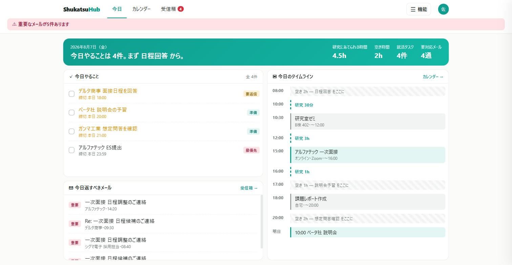
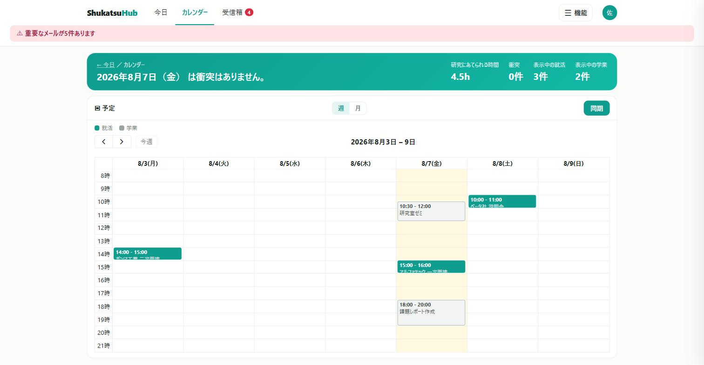
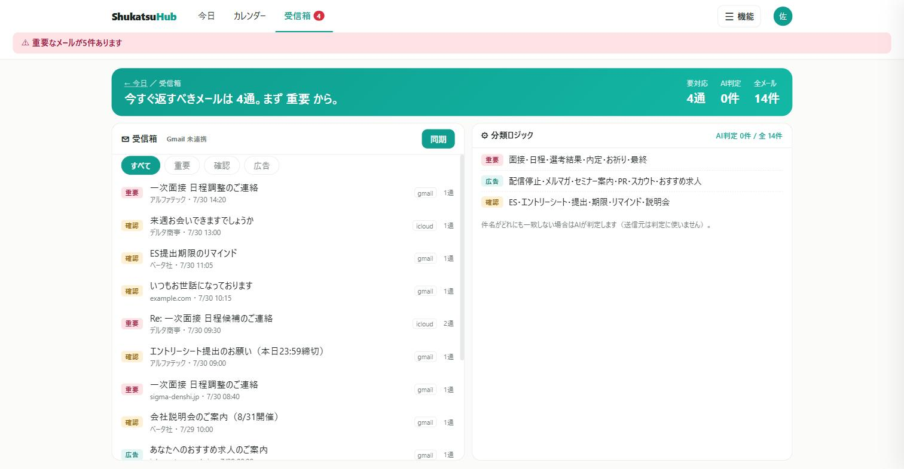
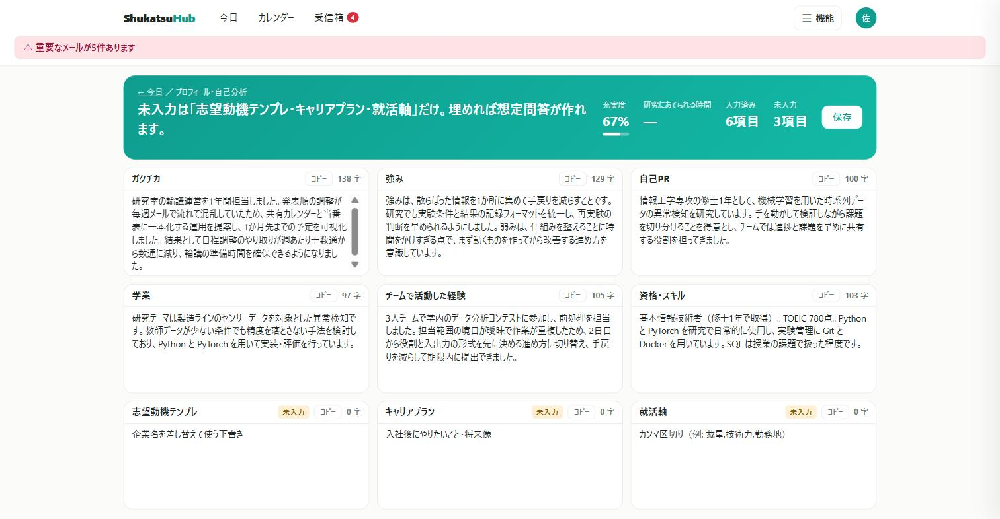
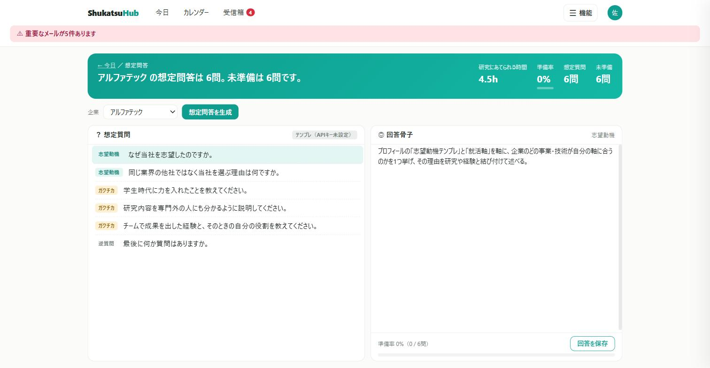

# ShukatsuHub（就活一元管理ダッシュボード）

複数の求人サイト・メールアカウントに散らばった就活の選考情報を1画面に集約し、
**情報整理と連絡対応の手間を最小化して、浮いた時間を研究や本業に充てる**ことを目的にしたダッシュボードです。

> チーム制のインターンシップ課題として開発したアプリを、個人のポートフォリオ用に移したものです。
> 私はフロントエンドとバックエンドの両方を担当し、Claude Code を使った
> **AI駆動開発（スペック駆動開発）**で実装しました。仕様の設計・レビュー・最終判断は自分たち人間が行っています。
> 詳しくは [AI駆動開発について](#ai駆動開発について) を参照してください。

## スクリーンショット（すべてダミーデータ）

| 今日（ホーム） | カレンダー |
|---|---|
|  |  |

| 受信箱 | プロフィール・自己分析 |
|---|---|
|  |  |

| 想定問答（AI生成） |
|---|
|  |

## 主な機能

| # | 機能 | 中身 |
|---|---|---|
| ① | 今日（ホーム） | 4指標（研究にあてられる時間・空き時間・就活タスク・要対応メール）・今日やること・返すべきメール・タイムライン・空きスロットへのタスク差し込み |
| ② | カレンダー | 週/月表示・就活と学業の衝突の可視化・同期（冪等）・Google カレンダー実連携（OAuth2）・面接候補日おすすめ |
| ③ | メールの自動振り分け | Gmail実連携（`gmail.metadata`のみ・本文は取得しない）＋iCloudモック統合・件名ベースのルール分類＋AIフォールバック・企業/スレッド単位の集約 |
| ④ | プロフィール・自己分析 | 9項目の保存・コピー・充実度% |
| ⑤ | 想定問答 | プロフィール＋企業情報からAIが想定質問と回答骨子を生成・準備率の可視化 |
| ⑥ | タスク・締め切り／選考ステータス管理 | 締切管理・5列カンバン・今日画面と空き時間へ反映 |
| ⑦ | 企業の発見・マッチング | 条件と重み付けによるマッチ率計算（AI不使用・同一条件なら常に同じ結果）・受信箱からの企業登録提案 |
| ⑧ | 企業研究・ナレッジ蓄積 | 公開情報のAI整理（出典明示）・面接振り返り等のメモ蓄積 |
| ⑨ | 通知 | 重要メール検知バナー・デスクトップ通知 |

## 技術スタック

| 層 | 技術 |
|---|---|
| Backend | Python 3.11 + FastAPI |
| ORM / DB | SQLModel + SQLite |
| Frontend | React + Vite + TypeScript |
| 通信 | TanStack Query |
| スタイル | 素の CSS（UIライブラリ不使用） |
| カレンダーUI | FullCalendar |
| AI | Azure OpenAI（Responses API・構造化出力） |
| 外部連携 | Google Calendar API / Gmail API（OAuth2） |
| テスト | pytest（バックエンド289件）／ Vitest（フロントエンド196件） |

設計判断や技術選定の理由は [`docs/decisions.md`](docs/decisions.md)、詳細仕様は [`docs/spec.md`](docs/spec.md) にまとめています。

## ローカルで動かす

```bash
# バックエンド
cd backend
pip install fastapi uvicorn sqlmodel python-dotenv pytest httpx openai
python -m seed.load
uvicorn main:app --reload   # http://localhost:8000/docs

# フロントエンド（別ターミナル）
cd frontend
npm install
npm run dev                 # http://localhost:5173
```

AI機能（メール分類のフォールバック・想定問答生成）はAPIキー無しでも動作します
（キー未設定時はルールベース／テンプレートに自動フォールバックする設計）。
詳しい手順は [`docs/setup.md`](docs/setup.md) を参照してください。

## AI駆動開発について

このプロジェクトは、AIにチャットで丸投げするのではなく、**ソフトウェア工学のやり方でAIを操縦する**
進め方（AI駆動開発ハッカソンキット）で作りました。

1. **アイデアを決める**
2. **`/spec`** → 対話で要件を詰め、仕様書 `docs/spec.md`（唯一の正・北極星）を作る
3. **`/feature`** → 仕様をもとに「実装 → コードレビュー修正 → テスト」をAIが自分で回す

見どころ：
- `/feature` 実行中、AIが「何を・なぜ・どのツールで」を言いながら動く（自律エージェント）
- レビュー役（`code-reviewer`）は**指摘するだけでコードは直さない**。直すのは実装役本体
  （承認欲しさに問題を隠すのを防ぐ設計）
- テストの期待値は**緑にするために緩めない**。落ちたテストは「仕様と実装のズレ」のサイン
- 仕様と実装がズレたら、まず仕様書に戻って直す（スペック駆動開発）
- ルール文書（`CLAUDE.md`等）は**AIが自分で変更しない**。変更は人の明示的な指示があるときだけ

実装にはAIを活用しましたが、**仕様の判断・コードレビューの承認・最終責任は人（私を含むチームメンバー）**
が担っています。
