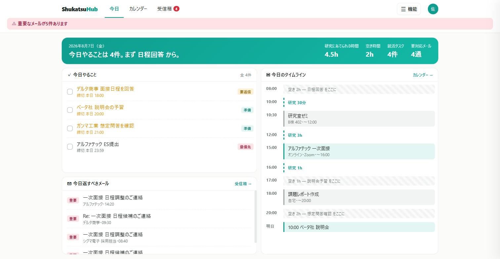
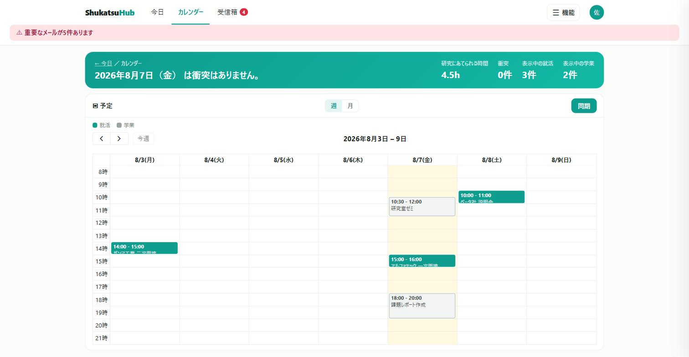
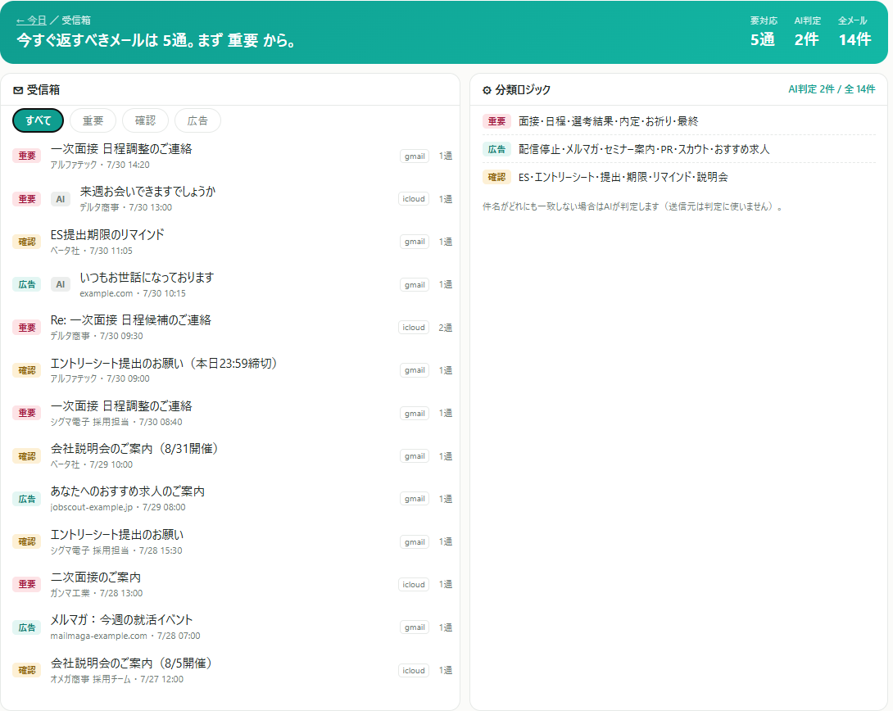
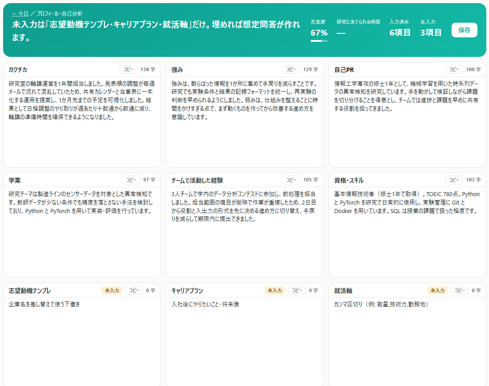
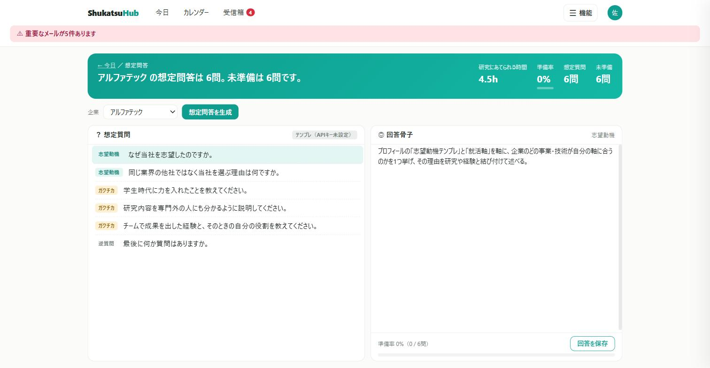
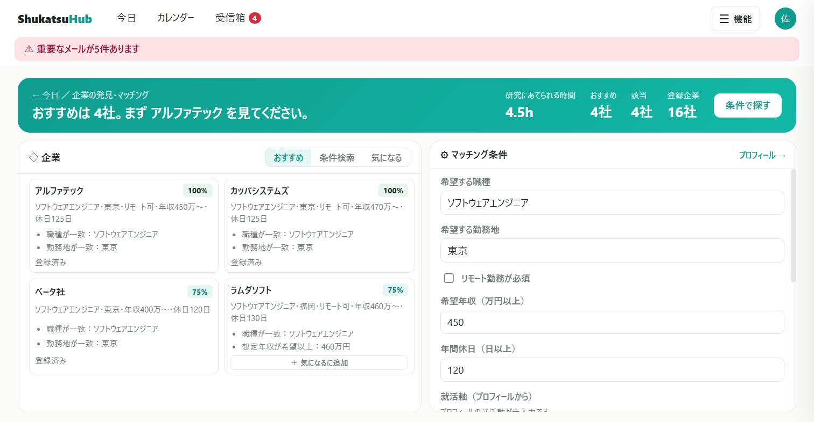

<!--
ポートフォリオ用の短縮版（元は社内インターンシップの最終発表資料）。
画像はすべてダミー企業（アルファテック・ベータ社・デルタ商事等）のスクリーンショット。
出力:
  npx @marp-team/marp-cli docs/slides/final.md --theme docs/slides/theme.css --pdf --allow-local-files -o docs/slides/final.pdf
-->

<!-- _class: title lead-shot -->

# 就活一元管理ダッシュボード ShukatsuHub

情報整理の手間を最小化し、浮いた時間を研究に充てる

個人ポートフォリオ版（元:チーム制インターンシップ課題）

---

## 何を解決するか

**ペルソナ**：理系大学院生・エントリー20〜30社（ピーク時）

- Gmail / iCloud / 求人サイト / Notion / スプレッドシートを**手動で行き来**
- メールの見逃し・選考状況の把握・日程の転記に時間を取られる
- **休日が就活と課題で潰れる**

### ゴール

情報整理と連絡対応の手間を最小化し、
**浮いた時間を研究に充てる**

そのため全画面の最上部に
<b>「研究にあてられる時間」</b>を常に置いた

---

<!-- _class: dense -->

## 実装した機能（12機能）

| # | 機能 | 中身 |
|---|---|---|
| ① | 今日（ホーム） | 4指標・今日やること・返すべきメール・タイムライン |
| ② | カレンダー | Google 連携（OAuth2）・衝突の可視化・候補日おすすめ |
| ③ | メールの自動振り分け | Gmail 連携・重要/確認/広告に分類・スレッド集約 |
| ④ | プロフィール・自己分析 | 9項目の保存・コピー・充実度% |
| ⑤ | 想定問答 | AI 生成・回答の保存・準備率 |
| ⑥⑦ | タスク／選考ステータス管理 | 締切の一元管理・5列カンバン |
| ⑧ | 企業の発見・マッチング | マッチ率（計算）・受信箱からの企業登録 |
| ⑨⑩ | 企業研究／ナレッジ蓄積 | 公開情報のAI整理・面接振り返りメモ |
| ⑪⑫ | 通知／外部連携 | 重要メール検知・Google Calendar/Gmail 実連携 |

<b>289</b>バックエンドのテスト

<b>196</b>フロントのテスト

<b>28</b>APIエンドポイント

<b>0</b>型エラー

---

## 今日 ＋ カレンダー

- 開いたら**今日の動きだけが分かる**。空き時間に締切が近いタスクを自動で差し込む
- Google カレンダー実連携（OAuth2）。`同期`は何回押しても件数が増えない設計
- 就活＝ティール・学業＝グレーで衝突が一目で分かる

---

## 受信箱：ルール優先 ＋ AIフォールバック

- Gmail 実連携（権限は`gmail.metadata`のみ・**本文を取得しない**）
- 件名のキーワードで重要／確認／広告に分類し、**判定できないものだけAIに回す**
- どの行がAI判定かを`AI`バッジで明示

---

## プロフィール ＋ 想定問答

- 9項目を1か所に保存し、コピーボタンでESにそのまま貼れる
- プロフィール＋企業情報からAIが想定質問と回答骨子を生成。**APIキーが無くてもテンプレに落ちる**

---

## 企業マッチング：AIを使わない設計

- マッチ率は **AIではなく重み付きの計算**（職種3・勤務地2・年収2・休日1・リモート1・軸1）
- 同じ条件なら**常に同じ結果**。「なぜ100%か」をその場で説明できる
- 年収・休日はAIに生成させず、企業に保存した値だけを使う

---

## 技術スタック

| 層 | 技術 |
|---|---|
| Backend | Python 3.11 + FastAPI ／ SQLModel + SQLite |
| Frontend | React + Vite + TypeScript ／ TanStack Query ／ 素の CSS |
| AI | Azure OpenAI（Responses API・構造化出力） |
| 外部連携 | Google Calendar API／Gmail API（OAuth2） |
| テスト | pytest（289件）／ Vitest（196件） |

**AIは3箇所だけに限定**：メール分類のフォールバック・想定問答の生成・企業研究の整理。
失敗時（キー未設定・通信失敗・refusal）は**例外を投げずフォールバック**する設計にした。

---

## AI駆動開発で作った

1. **`/spec`** — 対話で要件を詰め、仕様書（唯一の正）を作る
2. **`/feature`** — 仕様をもとに「実装 → コードレビュー修正 → テスト」をAIが自分で回す

- レビュー役は**指摘するだけでコードは直さない**（承認欲しさに問題を隠すのを防ぐ設計）
- テストの期待値は**緑にするために緩めない**。落ちたテストは仕様と実装のズレのサイン
- ルール文書は**AIが自分で変更しない**。変更は人の明示的な指示があるときだけ

実装にはAIを活用し、**仕様の判断・レビューの承認・最終責任は人**が担った。

---

<!-- _class: title -->

# まとめ

## 就活の手間を減らし、研究の時間を取り戻す

- ペルソナを1人に絞り、**その人の時間を返す**ことを基準に機能を選んだ
- **説明できることを優先**した（マッチ率は計算、AI出力には出典、規約は先に調査）

ご覧いただきありがとうございました
